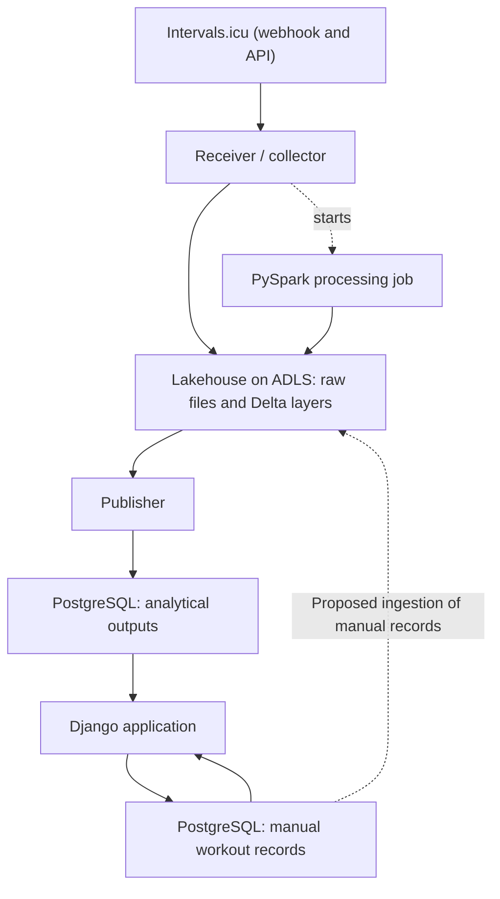

# Proposed architecture

**Status:** conceptual proposal; deployment details are not approved or tested.  
**Last updated:** 2026-10-28

## Responsibilities

| Component | Responsibility | Current choice |
| --- | --- | --- |
| Source integration | Make Zepp activity and wellness data available through Intervals.icu | Verified for sample reads |
| Receiver / collector | Receive webhook events, verify them, query the API where needed, and persist received payloads | Python on an Azure Function (D15, proposed); webhook registration unverified (F03) |
| Raw file storage | Preserve received payloads and collection metadata | ADLS Gen2 (D09) |
| Lakehouse processing | Validate, deduplicate, transform, and model data in Delta | PySpark and Delta Lake (D14), in an on-demand Azure Container Apps job (D15, proposed) |
| Publisher | Publish application-facing outputs consistently | The processing job, for example over JDBC (proposed, F05) |
| Application database | Store manual records and serve published results | PostgreSQL; Neon Free candidate |
| Web application | Authenticate the owner, collect manual records, and show results | Django; Vercel Hobby candidate |

## Logical data flow

The nodes below are responsibilities, not selected deployment units. The application-input path into the lakehouse is a proposed later integration.

The two PostgreSQL nodes represent logical responsibilities that could share one instance. They do not imply two hosted databases.

## Layer intent

| Area | Purpose | Design still required |
| --- | --- | --- |
| Raw files | Retain source payloads with acquisition context | Paths, format, naming, retention, completeness signal |
| Bronze | Preserve source fidelity and ingestion history | Whether raw landing and bronze are separate, metadata and write strategy |
| Silver | Provide validated, typed, deduplicated records | Keys, updates, time handling, quality rules |
| Gold | Provide dimensional analytical data and selected metrics | Business questions, fact grains, dimensions, formulas |
| PostgreSQL serving | Support efficient application queries | Published subset, consistency, ownership and permissions |
| PostgreSQL operational | Support manual workout and goal records | Normalized model and validation rules |

Do not add a separate layer only to satisfy terminology. Document the distinction between raw files and bronze once its value is established.

## Collection versus processing triggers

A storage trigger monitors storage. It does not discover new activities in Intervals.icu by itself. Something must first receive or query source data and write complete files.

Preferred approach (D10, conditional): Intervals.icu sends an `ACTIVITY_UPLOADED` webhook to an HTTPS endpoint. The endpoint verifies the request, writes the payload to ADLS, returns 2xx, and starts the processing job directly. An Event Grid trigger on blob creation is an alternative way to start the job. Whether a personal account can register a webhook is unverified (F03).

Wellness uses the `WELLNESS_UPDATED` webhook in the same way. A low-frequency safety-net poll catches missed activity or wellness events (Q15).

Fallbacks if webhooks are unavailable: scheduled API polling, or GitHub Actions (F09).

Webhook and trigger delivery are not guarantees of one run per event or immediate availability. Webhooks can be retried and duplicated. Processing must track which inputs were handled independently of the trigger.

## Application independence

Django should query PostgreSQL for already published data. Opening the application should not start a Spark job.

If processing is delayed, the application should retain access to previously published results and show their freshness. The consistency strategy for publishing a new result set is open.

Manual records belong to the operational application. Published analytical records are owned by the pipeline. The final design should prevent accidental overwriting across these responsibilities.

## Storage and deployment

ADLS Gen2 is the lake storage (D09). Processing runs as an on-demand container job rather than a standing cluster (D15, proposed), so compute is billed only while it runs. The choice must pass the [feasibility checks](feasibility.md).

Neon Free and Vercel Hobby are hosting candidates. Free plans have quotas and do not establish permanent availability guarantees. Access on demand does not require all compute to remain active continuously.

## Source control

Keep collector code, transformation code, SQL, Django code, migrations, job definitions, tests, and deployment configuration in this repository as they are introduced.

Container images, infrastructure definitions, and job configuration are versioned alongside the code. The deployment tooling is not yet chosen.

Runtime data and credentials remain outside Git. Use environment configuration or the relevant platform's secret facilities.

## Data protection and cost considerations

The real application requires authentication. Public registration and multi-user features are not required. Select the simplest suitable owner-access mechanism during design.

Health measurements and routes are private. Use synthetic examples in the repository and sanitized operational evidence.

The approved spending ceiling is 20 BRL per month (D16). Prefer free tiers where they exist. Before enabling a paid resource, establish an estimate from current prices, relevant quotas, and how charges are stopped. A budget alert alone is not a spending cap.

## Official references

Provider documentation reviewed during the initial discussion on 2026-10-26; recheck before implementation. Azure and Intervals.icu webhook references were added on 2026-10-28.

- [Intervals.icu API Integration Cookbook (webhooks)](https://forum.intervals.icu/t/intervals-icu-api-integration-cookbook/80090)
- [Azure Data Lake Storage Gen2 introduction](https://learn.microsoft.com/en-us/azure/storage/blobs/data-lake-storage-introduction)
- [Azure Container Apps jobs](https://learn.microsoft.com/en-us/azure/container-apps/jobs)
- [Azure Blob Storage events](https://learn.microsoft.com/en-us/azure/storage/blobs/storage-blob-event-overview)
- [Medallion architecture](https://learn.microsoft.com/en-us/azure/databricks/lakehouse/medallion)
- [Django on Vercel](https://vercel.com/docs/frameworks/full-stack/django)
- [Vercel Hobby](https://vercel.com/docs/plans/hobby)
- [Neon pricing](https://neon.com/pricing)
