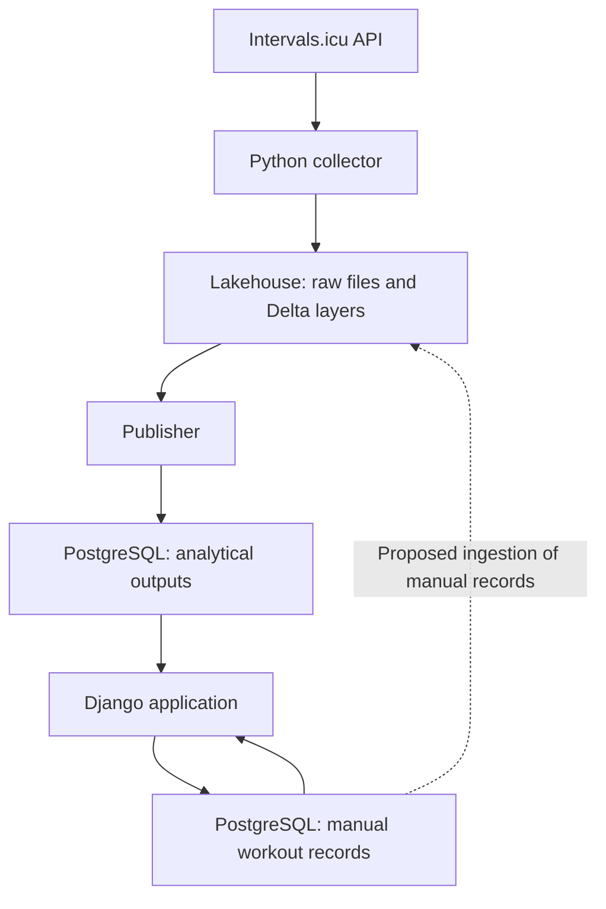

# Proposed architecture

**Status:** conceptual proposal; deployment details are not approved or tested.  
**Last updated:** 2026-10-26

## Responsibilities

| Component | Responsibility | Current choice |
| --- | --- | --- |
| Source integration | Make Zepp activity and wellness data available through Intervals.icu | Verified for sample reads |
| Collector | Query the API, handle collection state, and persist received payloads | Python; host and trigger open |
| Raw file storage | Preserve received payloads and collection metadata | Unity Catalog managed volume candidate |
| Lakehouse processing | Validate, deduplicate, transform, and model data in Delta | Databricks Free Edition, conditional |
| Publisher | Publish application-facing outputs consistently | Mechanism and execution location open |
| Application database | Store manual records and serve published results | PostgreSQL; Neon Free candidate |
| Web application | Authenticate the owner, collect manual records, and show results | Django; Vercel Hobby candidate |

## Logical data flow

The nodes below are responsibilities, not selected deployment units. The application-input path into the lakehouse is a proposed later integration.

The two PostgreSQL nodes represent logical responsibilities that could share one instance. They do not imply two hosted databases.

## Layer intent

| Area | Purpose | Design still required |
| --- | --- | --- |
| Raw files | Retain source payloads with acquisition context | Paths, format, naming, retention, completeness signal |
| Bronze | Preserve source fidelity and ingestion history | Whether raw landing and bronze are separate, metadata and write strategy |
| Silver | Provide validated, typed, deduplicated records | Keys, updates, time handling, quality rules |
| Gold | Provide dimensional analytical data and selected metrics | Business questions, fact grains, dimensions, formulas |
| PostgreSQL serving | Support efficient application queries | Published subset, consistency, ownership and permissions |
| PostgreSQL operational | Support manual workout and goal records | Normalized model and validation rules |

Do not add a separate layer only to satisfy terminology. Document the distinction between raw files and bronze once its value is established.

## Collection versus processing triggers

A file-arrival trigger monitors storage. It does not discover new activities in Intervals.icu by itself. A collector must first query or receive source data and write complete files.

Preferred processing trigger: file arrival, if supported in the actual Free Edition workspace. A direct job API invocation after collection or a scheduled processing job are alternatives requiring evaluation.

A trigger notification is not a guarantee of one run per file or immediate availability. Processing must track which inputs were handled independently of the trigger.

## Application independence

Django should query PostgreSQL for already published data. Opening the application should not start a Spark job.

If processing is delayed, the application should retain access to previously published results and show their freshness. The consistency strategy for publishing a new result set is open.

Manual records belong to the operational application. Published analytical records are owned by the pipeline. The final design should prevent accidental overwriting across these responsibilities.

## Storage and deployment

Databricks-managed storage is the leading candidate instead of ADLS Gen2. This choice must pass the [feasibility checks](feasibility.md). It does not assume access to arbitrary external cloud storage.

Neon Free and Vercel Hobby are hosting candidates. Free plans have quotas and do not establish permanent availability guarantees. Access on demand does not require all compute to remain active continuously.

## Source control

Keep collector code, transformation code, SQL, Django code, migrations, job definitions, tests, and deployment configuration in this repository as they are introduced.

Databricks code and notebooks can be versioned in Git. Declarative Automation Bundles are a deployment option to evaluate; their use in the chosen workspace has not been verified.

Runtime data and credentials remain outside Git. Use environment configuration or the relevant platform's secret facilities.

## Data protection and cost considerations

The real application requires authentication. Public registration and multi-user features are not required. Select the simplest suitable owner-access mechanism during design.

Health measurements and routes are private. Use synthetic examples in the repository and sanitized operational evidence.

Target a free setup. Before enabling a paid resource, establish the owner's spending limit, an estimate, relevant quotas, and how charges are stopped. A budget alert alone is not a spending cap.

## Official references

Provider documentation reviewed during the initial discussion on 2026-10-26; recheck before implementation.

- [Databricks Free Edition](https://docs.databricks.com/aws/en/getting-started/free-edition)
- [Free Edition limitations](https://docs.databricks.com/aws/en/getting-started/free-edition-limitations)
- [Unity Catalog volumes](https://docs.databricks.com/aws/en/files/volumes)
- [File-arrival triggers](https://docs.databricks.com/aws/en/jobs/file-arrival-triggers)
- [Medallion architecture](https://learn.microsoft.com/en-us/azure/databricks/lakehouse/medallion)
- [Databricks CI/CD](https://docs.databricks.com/aws/en/dev-tools/ci-cd)
- [Django on Vercel](https://vercel.com/docs/frameworks/full-stack/django)
- [Vercel Hobby](https://vercel.com/docs/plans/hobby)
- [Neon pricing](https://neon.com/pricing)
